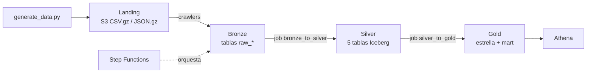

# Lakehouse en AWS — Bases de Datos II

Plataforma lakehouse en AWS (us-east-1) creada **solo con Terraform**: landing → bronze → silver (Iceberg) → gold
(estrella en Iceberg), orquestada con Step Functions y consultada con Athena. Meta de sustentación: más de 10M de filas
en `fact_sales`, con alerta de AWS Budgets en 5 USD.

> Estado del Avance 2: ver `docs/evidence/README.md` (capturas) y `docs/RUNBOOK_AVANCE2.md` (pasos y cifras esperadas).

## 1. Problema

Un comercio con ventas en varios departamentos necesita responder preguntas de negocio (por ejemplo: *¿qué departamento
lidera las ventas por rango de edad y trimestre?*) sobre sus datos transaccionales. En el OLTP esa pregunta exige 8 o más
joins; en la estrella exige 3 o 4, y con el mart agregado, ninguno.

## 2. Arquitectura medallón



| Capa | Pregunta que responde | Contenido |
|---|---|---|
| Landing | ¿Qué llegó, exactamente como llegó? | Archivos sin modificar, por `ingest_date`. |
| Bronze | ¿Qué estructura tiene? | Tablas `raw_*` creadas por crawlers. Conserva duplicados y datos sucios. |
| Silver | ¿Qué datos son confiables? | 5 tablas Iceberg tipificadas, normalizadas, validadas y deduplicadas. |
| Gold | ¿Qué necesita el negocio? | `fact_sales`, 5 dimensiones y el mart `agg_sales_dept_age_quarter`. |

## Dataset

Los datos son **sintéticos** y los genera `data/generate_data.py` (determinista: mismos parámetros, mismos datos).
Incluye suciedad intencional (duplicados, correos inválidos, cantidades negativas, fechas futuras, texto desordenado)
para que silver tenga algo que limpiar.

| Dónde | Qué hay | Cómo verlo |
|---|---|---|
| `data/sample/` (en Git) | 20 filas de cada tabla + 3 filas sucias de ejemplo | Abrir los `.csv` |
| `data/out/` (local, no va a Git) | Archivos completos generados | `zcat ...part-0001.csv.gz \| head` |
| S3 `landing/` | Mismos archivos sin modificar | Consola S3 / `aws s3 ls` |
| Athena `lakehouse_bronze.raw_*` | Tablas sobre landing (incluye lo sucio) | `SELECT * ... LIMIT 10` |
| Athena `lakehouse_silver.*` y `lakehouse_gold.*` | Datos limpios y modelo estrella | `SELECT * ... LIMIT 10` |
| S3 `silver/_rejects/` | Filas rechazadas con su motivo | Consola S3 |

Regenerar la muestra: `cd data && python make_sample.py --ingest-date 2026-11-07`.

## 3. Estructura del repositorio

```
terraform/   infraestructura (S3, Glue, Athena, IAM, Budgets, Step Functions)
jobs/        scripts que ejecuta Glue: bronze_to_silver.py, silver_to_gold.py
helpers/     funciones reutilizables importadas por los jobs
data/        generate_data.py (generador), make_sample.py y sample/ (muestra en Git)
sql/         consultas de Athena: negocio, capacidades Iceberg, volumen
docs/        guía en PDF, runbook y evidencias
```

## 4. Decisiones de diseño

- **Iceberg** en silver y gold (UPDATE/DELETE, time travel, particionado oculto) en lugar de Parquet plano.
- **Spark nativo**: los jobs usan solo la API de DataFrames, sin `spark.sql`. Iceberg no expone MERGE en esa API,
  así que el upsert se implementa con `left_anti join` + `overwritePartitions` (`helpers/iceberg_io.py`).
- **Surrogate keys** `abs(xxhash64(clave_natural))`: deterministas e idempotentes; fila `-1 / Unknown` en cada dimensión.
- **SCD tipo 1**: las dimensiones se reconstruyen desde silver en cada corrida.
- **1 bucket con prefijos**: `landing/ silver/ gold/ scripts/ athena-results/ glue-temp/ warehouse/`.
- **Silver con 5 tablas** (una por entidad transaccional) y **gold con 7** (hechos, 5 dimensiones y 1 mart).
  Los `web_events` se quedan en landing/bronze porque ningún requisito de negocio los consume.
- **Privacidad**: nombre y correo viven solo en silver; gold no los contiene.
- **Particionado**: `months(order_date)` en `orders` y `fact_sales`; compresión zstd.

## 5. Cómo desplegar y correr

```bash
export AWS_PROFILE=lakehouse
cd terraform && terraform init && terraform plan -out=tfplan && terraform apply tfplan
```

Generar y cargar datos, correr el pipeline y verificar: `docs/RUNBOOK_AVANCE2.md`.

## 6. Calidad de datos

Cada entidad pasa por `quality_gate` (`helpers/quality.py`): los registros inválidos se guardan en
`silver/_rejects/<entidad>/ingest_date=.../` con su motivo (`_reject_reason`) y el job falla si se rechaza más del 5 %.
Reglas: claves nulas, correo inválido, fecha futura, cantidad menor o igual a 0, ubicación o categoría faltante.
Los resultados quedan en los logs `[QUALITY]` de CloudWatch. Los duplicados se eliminan conservando el registro más reciente.

## 7. Modelo estrella

`fact_sales` (grano: línea de pedido) con claves a `dim_customer`, `dim_product`, `dim_store`, `dim_geography` y `dim_date`.
Diccionario completo en la sección 1 de `docs/Guia_Definitiva_Lakehouse_AWS_v2.pdf`.

## 8. Preguntas de negocio

Consultas en `sql/04_questions.sql`. Para cada una, completar con la captura:

| Pregunta | Resultado | Interpretación | Tiempo / Data scanned |
|---|---|---|---|
| Q1: top 3 departamentos por trimestre | _pendiente_ | _pendiente_ | _pendiente_ |
| Q2: ventas y ticket por rango de edad | _pendiente_ | _pendiente_ | _pendiente_ |
| Q3: departamento líder por edad y trimestre (estrella y mart) | _pendiente_ | _pendiente_ | _pendiente_ |

## 9. Upsert, UPDATE, DELETE y time travel

- Lote 2 (`ingest_date=2026-11-09`): +4.000 pedidos nuevos y 1.000 pedidos actualizados a `returned`. Evidencia: `docs/evidence/18-merge.png`.
- UPDATE, DELETE (derecho al olvido), time travel y mantenimiento: `sql/05_lakehouse.sql`.

## 10. Volumen, costos y seguridad

| Medida | Valor |
|---|---|
| Filas en `fact_sales` (perfil full) | _pendiente_ |
| Gasto real de Glue vs presupuesto (5 USD) | _pendiente_ |

Seguridad: usuario `lakehouse-admin` con MFA y tres roles de mínimo privilegio (crawlers, jobs, Step Functions) definidos
en Terraform; Budgets con 4 alertas; el CSV de la access key nunca va al repositorio.

Cierre: `terraform destroy` y verificación de que no queda nada.
