# Evidencias

# Aqui se pueden observar las evidencias de cada aspecto trabajado en el proyecto

1 Terraform Apply complete! Resources: 31 added 
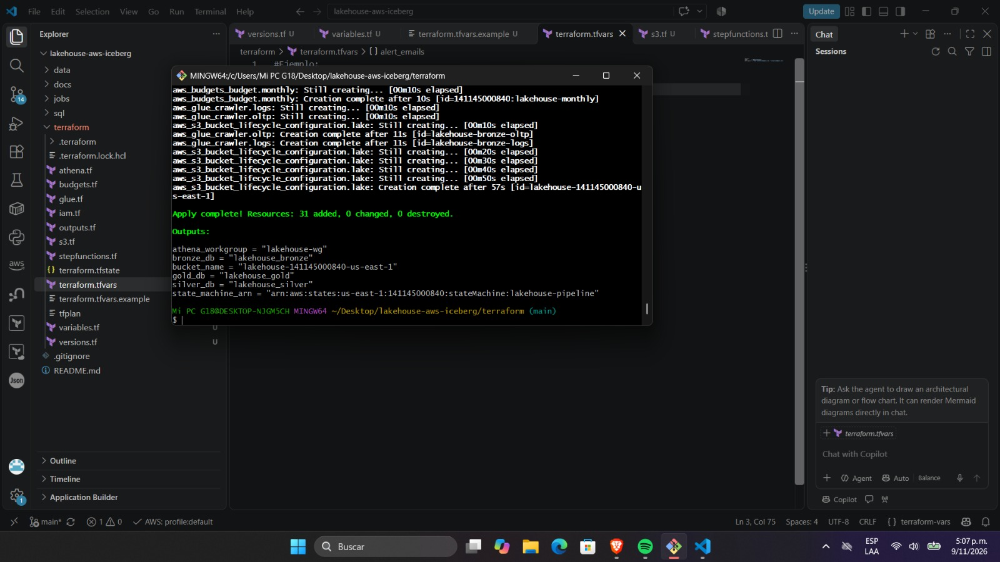

2 Terraform S3: bucket con sus prefijos 
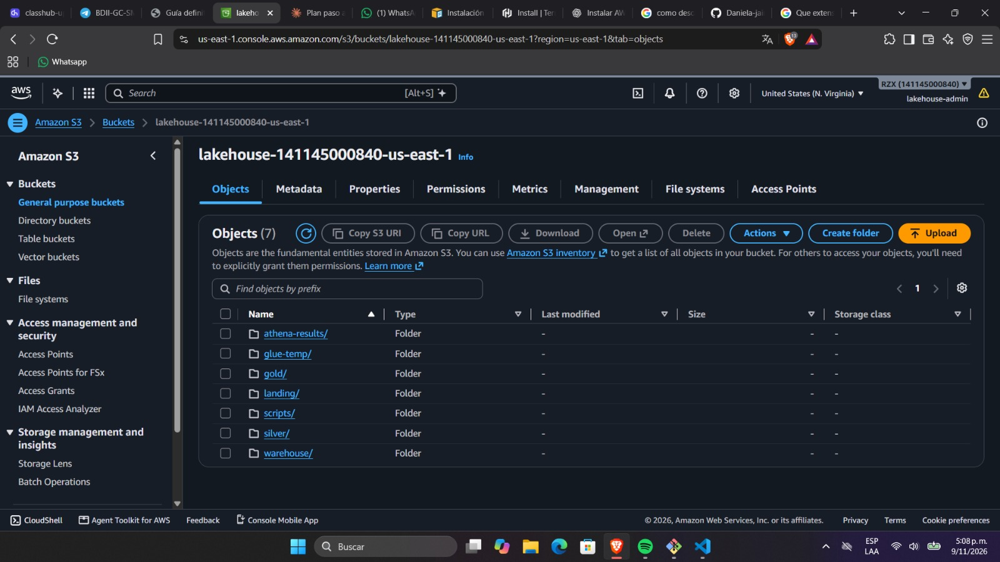

3 Terraform Budgets: 4 alertas
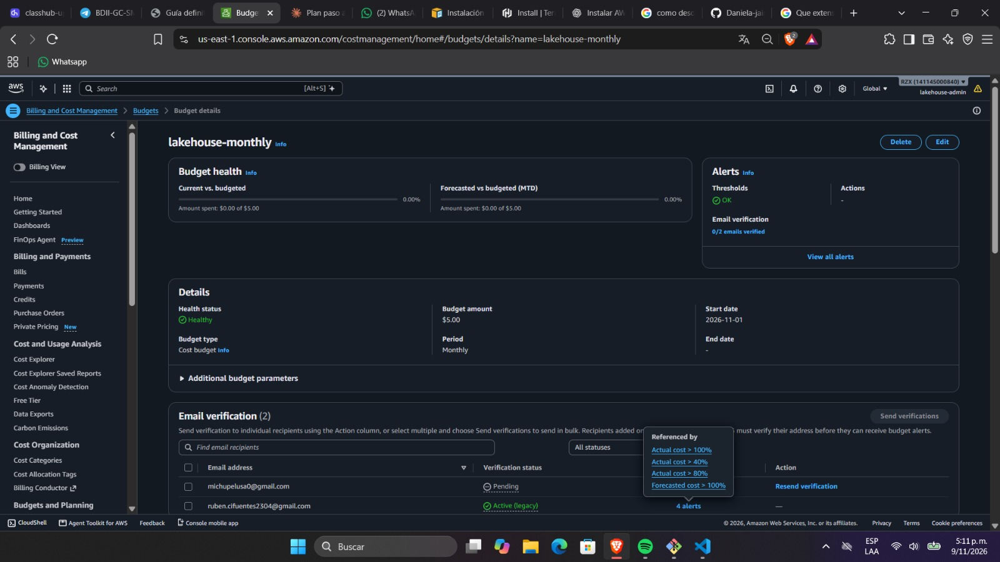

4 Terraform Athena: workgroup lakehouse-wg, engine v3
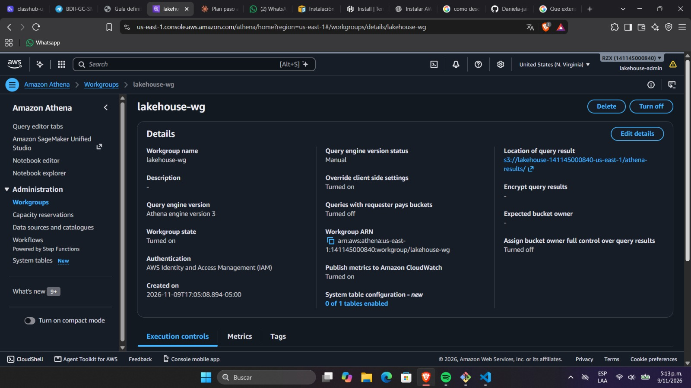

5 Terraform Glue: 3 bases de datos
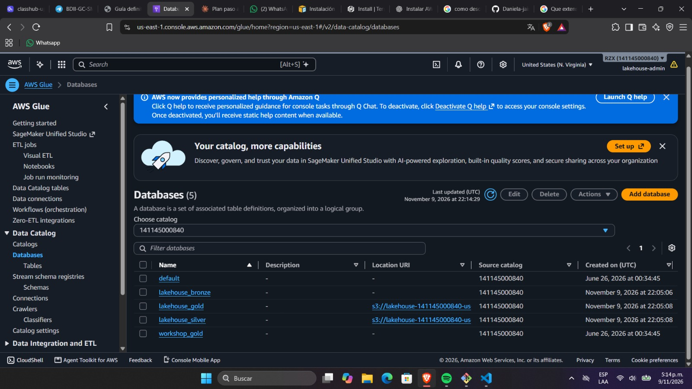

6 Terraform Glue: los 2 jobs
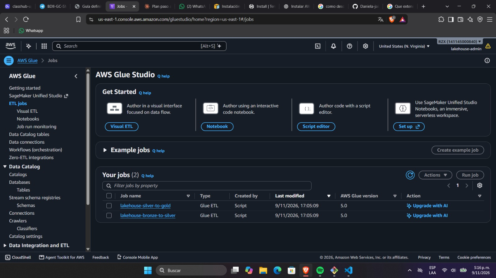

7 Terraform Step Functions: lakehouse-pipeline
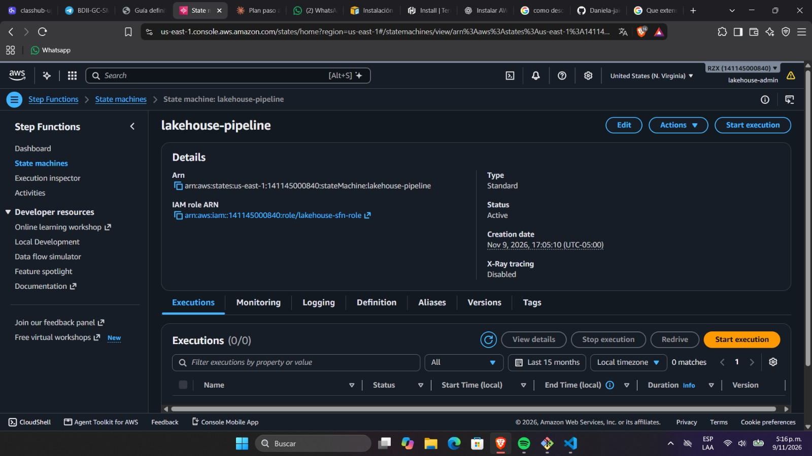

8 Terraform IAM: 3 roles y usuario con MFA
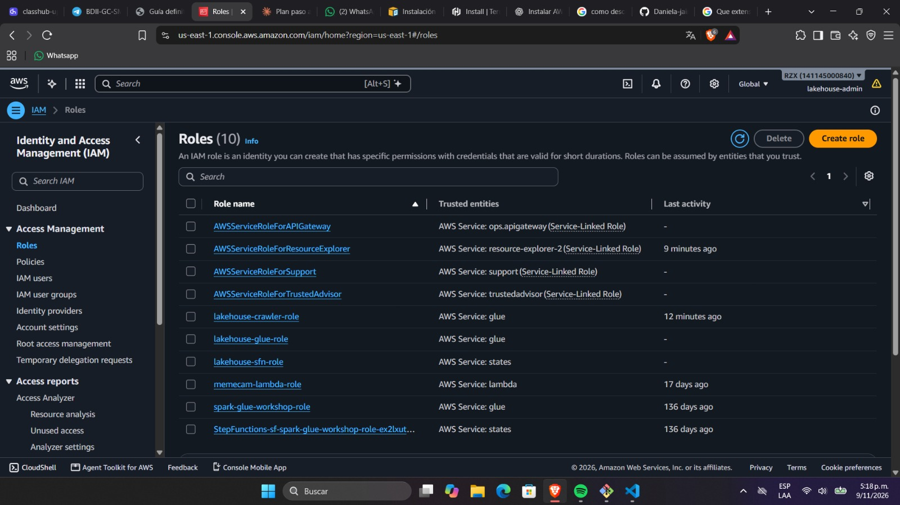
 
9 S3 `landing/` con `ingest_date=...` 

10 Crawlers en Succeeded 
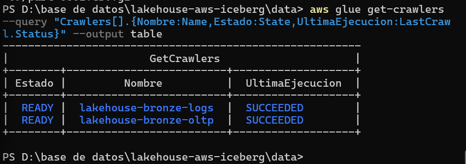

11 Tablas `raw_*` y conteo en Athena 

12 Run `bronze-to-silver` en Succeeded (duración, DPU-horas) 

13 CloudWatch: líneas `[QUALITY]` 
![CloudWatch: líneas `[QUALITY]`](./images/13-quality-logs.png)

14 `silver/_rejects/` y 5 tablas de silver 

14 `silver/_rejects/` y 5 tablas de silver 

15 Run `silver-to-gold` en Succeeded 

16 7 tablas de gold en Glue 
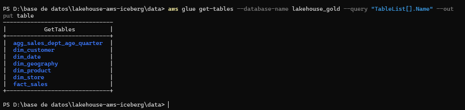

17 Step Functions: grafo en verde 
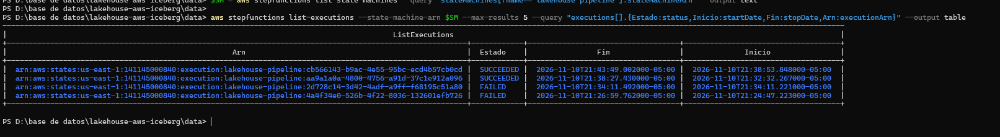

18 Conteos antes/después del lote 2  
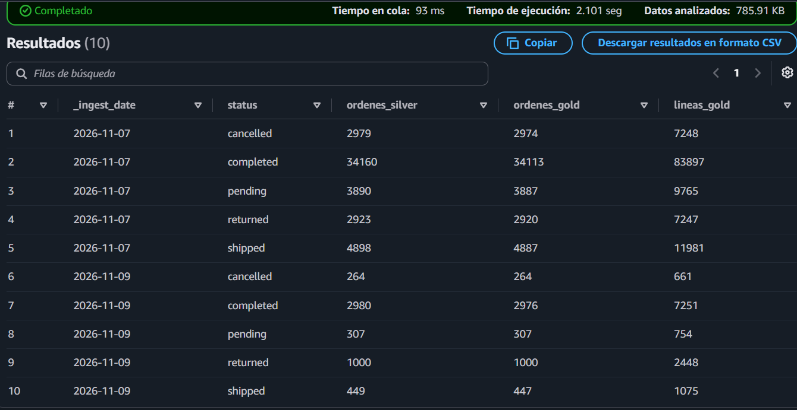
