# Evidencias

# Aqui se pueden observar las evidencias de cada aspecto trabajado en el proyecto

1 Terraform Apply complete! Resources: 31 added 

2 Terraform S3: bucket con sus prefijos 

3 Terraform Budgets: 4 alertas

4 Terraform Athena: workgroup lakehouse-wg, engine v3

5 Terraform Glue: 3 bases de datos

6 Terraform Glue: los 2 jobs

7 Terraform Step Functions: lakehouse-pipeline

8 Terraform IAM: 3 roles y usuario con MFA

 
9 S3 `landing/` con `ingest_date=...` 

10 Crawlers en Succeeded 

11 Tablas `raw_*` y conteo en Athena 

12 Run `bronze-to-silver` en Succeeded (duración, DPU-horas) 

13 CloudWatch: líneas `[QUALITY]` 
![CloudWatch: líneas `[QUALITY]`](./images/13-quality-logs.png)

14 `silver/_rejects/` y 5 tablas de silver 

14 `silver/_rejects/` y 5 tablas de silver 

15 Run `silver-to-gold` en Succeeded 

16 7 tablas de gold en Glue 

17 Step Functions: grafo en verde 

18 Conteos antes/después del lote 2  

19 SQL (mini): Q1 con resultado, tiempo y Data scanned
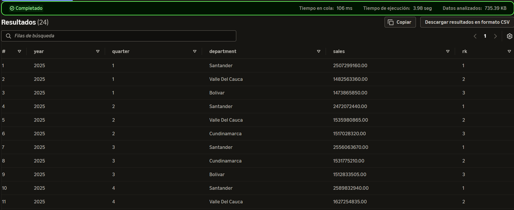

20 SQL (mini): Q2 con resultado, tiempo y Data scanned
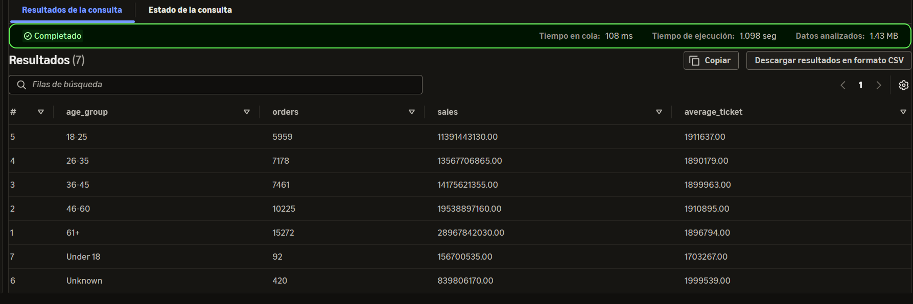

21 SQL (mini): Q3 con resultado, tiempo y Data scanned
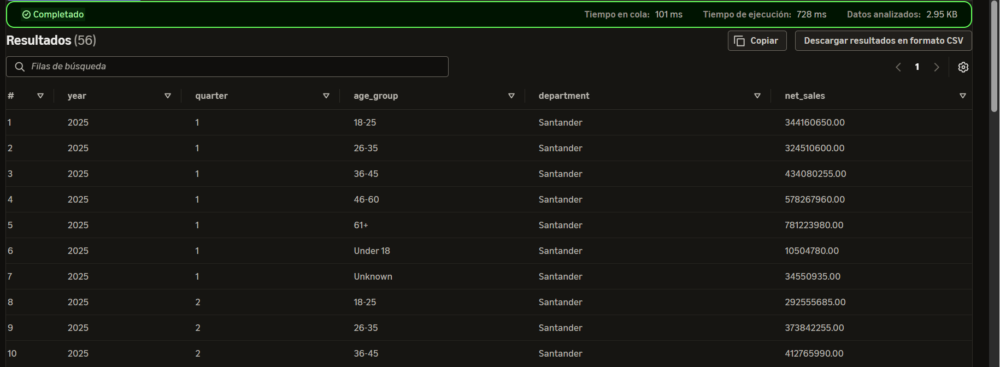

22 SQL: $snapshots
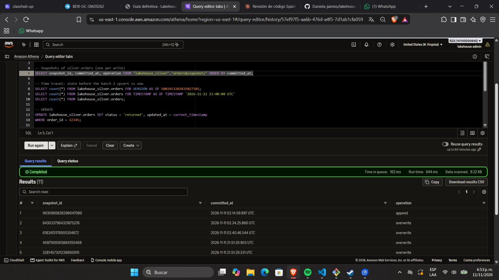

22.1 SQL: timetravel
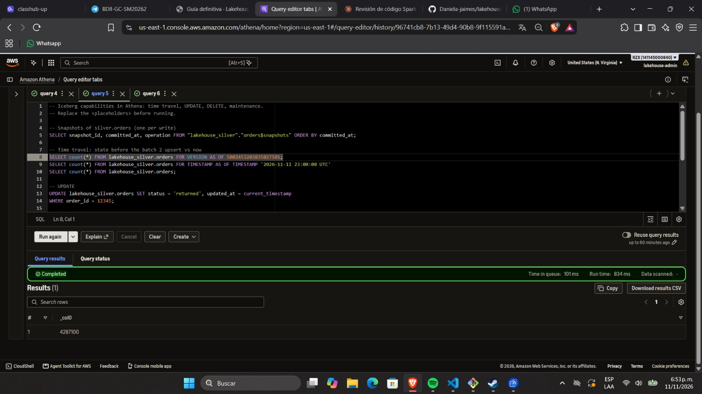

22.2 SQL: current_count
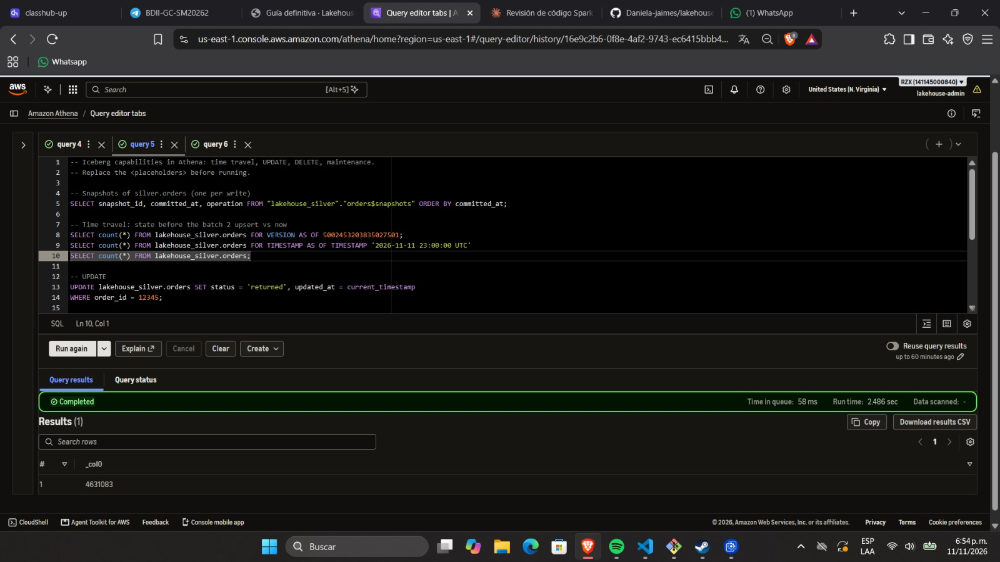

23 SQL: UPDATE y DELETE con verificación en 0
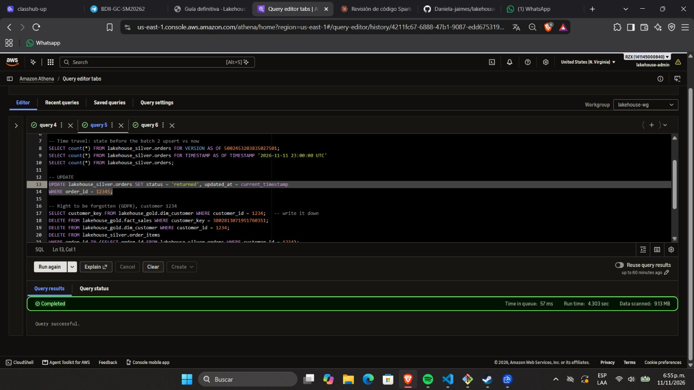

24 Full: fact_sales ≥ 10M y total entre capas
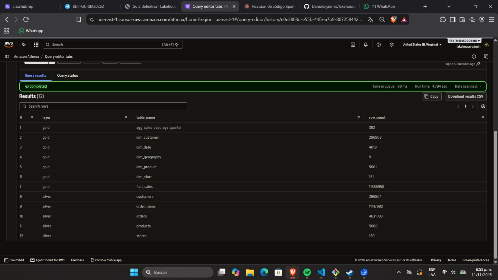

25 Full: duración y DPU-horas de la corrida full
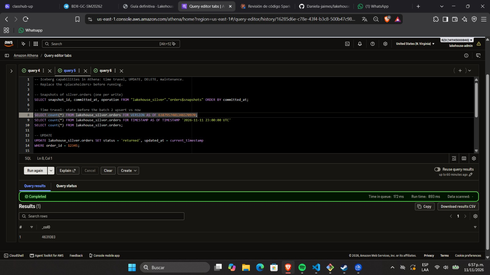

26 Full: integridad referencial en 0
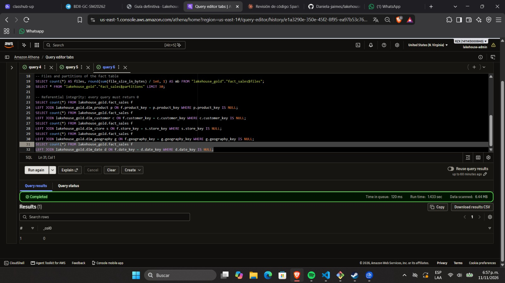

27.1 Costos: Cost Explorer 
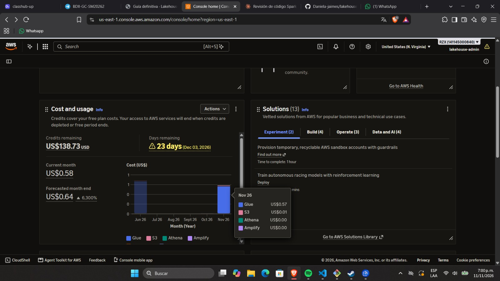

27.1 Costos: Cost glue
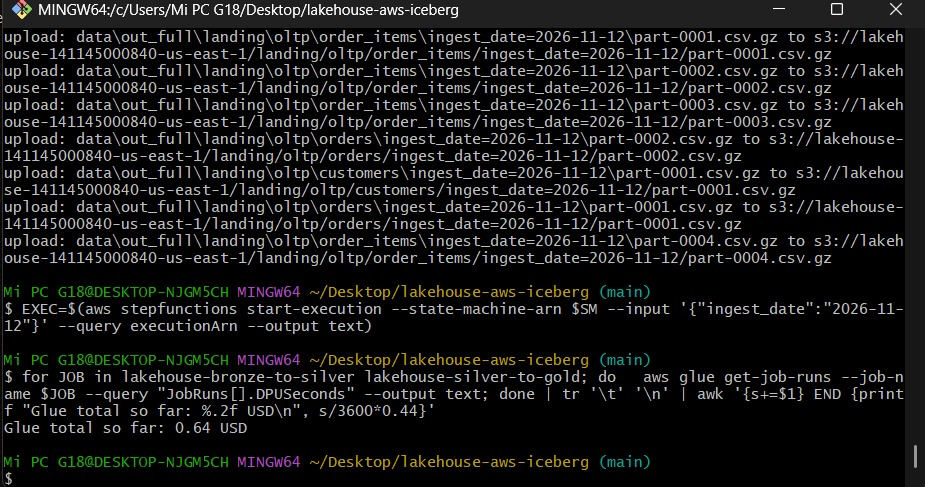

29 SQL (full): Q1 con resultado, tiempo y Data scanned
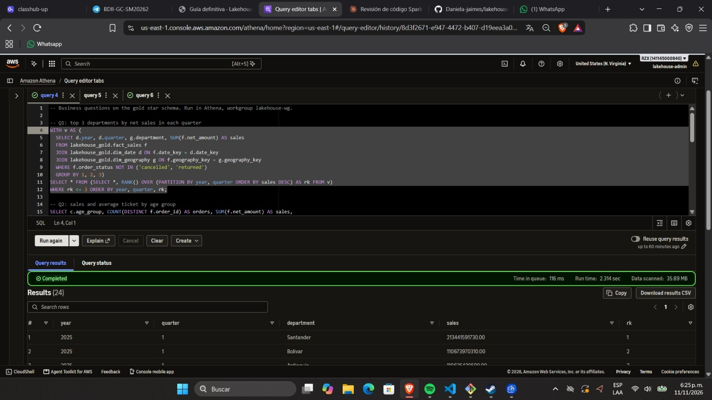

30 SQL (full): Q2 con resultado, tiempo y Data scanned
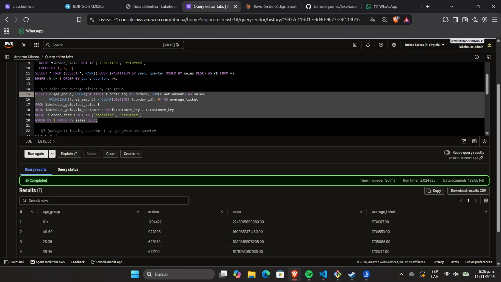

31.1 SQL (full): Q3 sobre la estrella (con joins), con resultado, tiempo y Data scanned
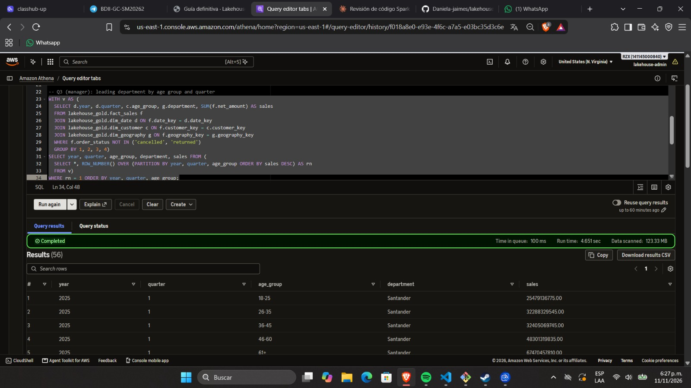

31.2 SQL (full): Q3 sobre el data mart (sin joins), con resultado, tiempo y Data scanned
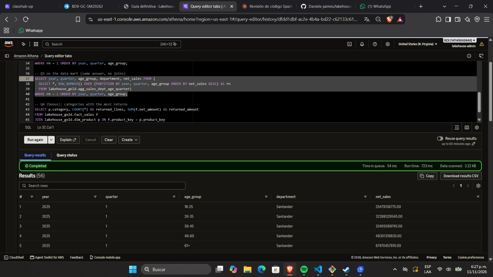

32 SQL (full): Q4 categorías con más devoluciones, con resultado, tiempo y Data scanned

33 Cierre: terraform destroy y verificación

